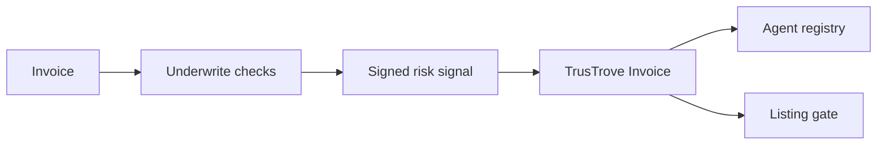

# Underwrite Verification Agent

[](https://github.com/UnderWritex402/UnderWrite-app/actions/workflows/ci.yml)


Underwrite is an invoice verification layer for Stellar. A verification agent checks an invoice, signs a risk signal, and posts it to a Soroban registry. TrusTrove lists an invoice for financing only if a valid attestation exists. This repository contains the off-chain verification pipeline, scoring code, evidence storage, signing code, and Soroban submission client.

Testnet only. Unaudited. No mainnet deployment exists. End-to-end flow: in progress.

## How the repositories fit together

| Repository | Role |
| --- | --- |
| [`UnderWrite-app`](https://github.com/UnderWritex402/UnderWrite-app) | Off-chain verification agent in this repository. |
| [`UnderWrite-contract`](https://github.com/UnderWritex402/UnderWrite-contract) | Soroban registry for approved agent keys and status. |
| [`TrusTrove-contract`](https://github.com/TrusTrove/TrusTrove-contract) | Invoice contract that calls the registry through `submit_attestation`. |

All three repositories are needed for the full flow.



## What the agent checks

The implemented pipeline reads TrusTrove platform history, checks Nigerian CAC registration data through a configured provider, searches the web for adverse findings, and analyzes invoice document bytes. It produces a risk signal in basis points from `0` to `10000`. The result is not a credit score and is not a guarantee that an invoice will pay.

## Maintainers

| Name | Role | GitHub | Telegram |
| --- | --- | --- | --- |
| Fuhad Adesanya | Maintainer | [@K1NGD4VID](https://github.com/K1NGD4VID), [@fadesany](https://github.com/fadesany) | [@K1NGD4VID](https://t.me/K1NGD4VID) |

## Quick Start

Prerequisite: Node.js 20 or newer.

```bash
git clone https://github.com/UnderWritex402/UnderWrite-app.git
cd UnderWrite-app
npm ci
npm run typecheck
npm test
npm run build
```

The current suite has 122 tests across 11 files. The commands above were checked from a fresh clone.

The package currently exposes a TypeScript library. It does not include a runnable HTTP server or CLI entrypoint.

## Environment variables

Configuration is validated per subsystem. Do not commit `.env` files.

| Name | Purpose | Required | Source |
| --- | --- | --- | --- |
| `AGENT_EVM_PRIVATE_KEY` | Signs attestation content and controls the ERC-8004 identity. | Yes for signing or identity calls | Generate and store as an operator secret. |
| `AGENT_ID` | Soroban `Symbol` used in the signed payload. | Yes for signing | Registered agent configuration. |
| `STELLAR_RPC_URL` | Soroban RPC endpoint. | Yes for submission | Stellar network provider. |
| `STELLAR_NETWORK_PASSPHRASE` | Network passphrase used to build transactions. | Yes for submission | Stellar network configuration. |
| `STELLAR_SUBMITTER_SECRET` | Pays and signs the Soroban submission transaction. | Yes for submission | Funded testnet account secret. |
| `TRUSTROVE_INVOICE_CONTRACT` | Contract that exposes `submit_attestation`. | Yes for submission | TrusTrove testnet deployment. |
| `TRUSTROVE_INDEXER_URL` | Base URL for invoice and counterparty history. | Yes for platform history | TrusTrove indexer deployment. |
| `TRUSTROVE_INDEXER_API_KEY` | Optional indexer credential. | No | TrusTrove indexer operator. |
| `CAC_LOOKUP_PROVIDER` | Selects `dojah`, `mono`, or `zeeh`. | Yes for CAC lookup | Operator choice. |
| `CAC_LOOKUP_BASE_URL` | CAC provider API base URL. | Yes for CAC lookup | Provider documentation. |
| `CAC_LOOKUP_API_KEY` | CAC provider credential. | Yes for CAC lookup | Provider dashboard. |
| `CAC_LOOKUP_APP_ID` | Additional provider application ID. | Required only when the selected provider needs it | Provider dashboard. |
| `WEB_SEARCH_PROVIDER` | Selects `brave`, `tavily`, or `serper`. | Yes for web research | Operator choice. |
| `WEB_SEARCH_API_KEY` | Search provider credential. | Yes for web research | Provider dashboard. |
| `WEB_SEARCH_MAX_RESULTS` | Result cap from `1` to `20`; defaults to `10`. | No | Operator configuration. |
| `GOAT_NETWORK` | Selects `goat-mainnet` or `goat-testnet`; defaults to testnet. | No | GOAT Network configuration. |
| `GOAT_RPC_URL` | Optional GOAT RPC override. | No | RPC provider. |
| `ERC8004_AGENT_ID` | Numeric identity assigned after registration. | No | ERC-8004 registry result. |
| `AGENT_REGISTRATION_URI` | Durable URL for the agent registration document. | No | Operator-hosted document. |
| `MERCHANT_PORTAL_BASE_URL` | x402 merchant portal endpoint. | Yes for payment checks | Merchant portal deployment. |
| `MERCHANT_PORTAL_EMAIL` | Merchant login identifier. | Yes for payment checks | Merchant account. |
| `MERCHANT_PORTAL_PASSWORD` | Merchant login secret. | Yes for payment checks | Merchant account. |
| `EVIDENCE_STORE_DIR` | Directory for evidence JSON; defaults to `./.evidence`. | No | Local operator configuration. |

## Attestation format

`invoice_id` is a 32-byte value. The client rejects any other length. The signed payload is the Soroban XDR encoding of this struct:

```rust
pub struct AttestationPayload {
    pub domain_separator: BytesN<32>,
    pub invoice_id: BytesN<32>,
    pub risk_score: u32,
    pub evidence_hash: BytesN<32>,
    pub agent_id: Symbol,
    pub nonce: u64,
}
```

The digest is `keccak256(payload)`. The agent signs it with secp256k1 and sends the XDR payload and 65-byte signature to `submit_attestation`. See [`packages/agent/src/attestation.ts`](packages/agent/src/attestation.ts) and [`packages/agent/src/submit.ts`](packages/agent/src/submit.ts).

## Security and license

Read [SECURITY.md](SECURITY.md) before reporting a vulnerability. Audit status: unaudited.

No `LICENSE` file is present. The repository owner must select a license before contributors can rely on reuse terms.

## Contributing

Read [CONTRIBUTING.md](CONTRIBUTING.md), then:

1. Pick an unassigned issue with no unmet dependency.
2. Create a branch such as `feat/123-short-name` from `main`.
3. Use Conventional Commits, for example `test(attestation): cover invalid payloads`.
4. Open a pull request that links the issue, includes tests, updates docs, and passes CI.

## Contributors

[](https://github.com/UnderWritex402/UnderWrite-app/graphs/contributors)
