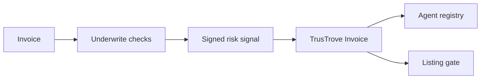

# Underwrite Verification Agent

Underwrite is an invoice verification layer for Stellar. A verification agent checks an invoice, signs a risk signal, and posts it to a Soroban registry. TrusTrove lists an invoice for financing only if a valid attestation exists. This repository contains the off-chain verification pipeline, scoring code, evidence storage, signing code, and Soroban submission client.

Testnet only. Unaudited. No mainnet deployment exists. End-to-end flow: in progress.

## How the repositories fit together

| Repository | Role |
| --- | --- |
| [`UnderWrite-app`](https://github.com/UnderWritex402/UnderWrite-app) | Off-chain verification agent in this repository. |
| [`UnderWrite-contract`](https://github.com/UnderWritex402/UnderWrite-contract) | Soroban registry for approved agent keys and status. |
| [`TrusTrove-contract`](https://github.com/TrusTrove/TrusTrove-contract) | Invoice contract that calls the registry through `submit_attestation`. |

All three repositories are needed for the full flow.

## What the agent checks

The implemented pipeline reads TrusTrove platform history, checks Nigerian CAC registration data through a configured provider, searches the web for adverse findings, and analyzes invoice document bytes. It produces a risk signal in basis points from `0` to `10000`. The result is not a credit score and is not a guarantee that an invoice will pay.

## Maintainers

| Name | Role | GitHub | Telegram |
| --- | --- | --- | --- |
| `{{NAME}}` | Maintainer | `{{GITHUB}}` | `{{TELEGRAM}}` |

Community: `{{COMMUNITY_LINK}}`

Demo video: `{{DEMO_VIDEO_URL}}`
