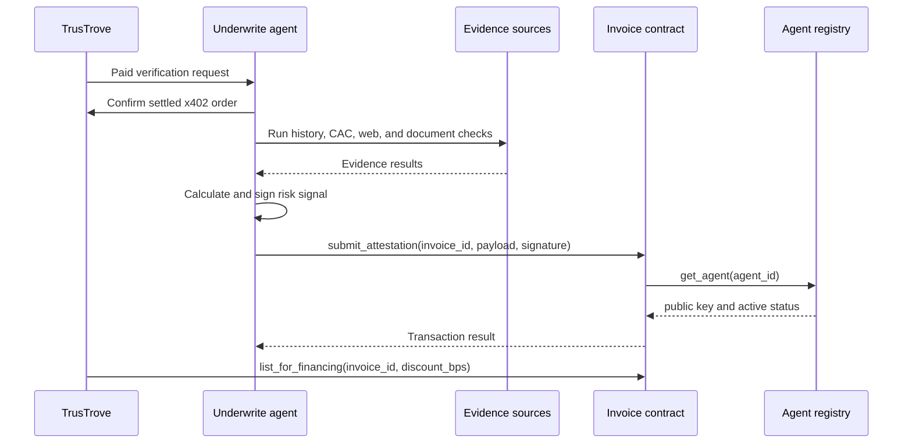

# How It Works

Underwrite separates evidence gathering from the on-chain trust check.

## Off-chain work

The app verifies that the payment order is settled before research begins. It runs the three remote evidence sources concurrently and runs document forensics locally. Each remote source returns either a validated result or an unavailable reason.

The scoring function combines available source scores and applies an unavailability penalty. When required evidence is missing, the pipeline returns `insufficient_evidence` and does not sign an attestation.

The evidence report is serialized canonically and stored off-chain. Its Keccak-256 hash becomes `evidence_hash` in the signed payload.

## On-chain work

The Invoice contract decodes the payload, checks its domain and invoice ID, recovers the secp256k1 public key, and calls `get_agent`. The signer must match an active registry record. One invoice can store one attestation.

`list_for_financing` then checks that the attestation exists. It also requires issuer authorization, re-checks issuer and buyer verification, and limits `discount_bps` to `5000`.

## Current limits

- One admin-registered Underwrite agent is used for the MVP.
- The system is testnet-only and unaudited.
- The app is a TypeScript library. A runnable HTTP service and general CLI are not present.
- Live end-to-end evidence has not been recorded, so the complete flow remains in progress.
