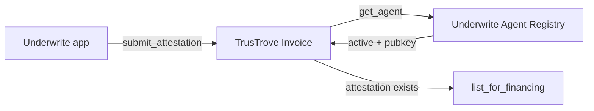

# Smart Contracts Overview

Underwrite uses two Soroban contracts in the verification path.



## Testnet addresses

| Contract | Repository | Testnet address |
| --- | --- | --- |
| Underwrite agent registry | [`UnderWrite-contract`](https://github.com/UnderWritex402/UnderWrite-contract) | [`CB22R3OJUCQGHZCXH5WAONTURVMSGDIDGIGXA2XQ6UNXDUKYWZKVTER5`](https://stellar.expert/explorer/testnet/contract/CB22R3OJUCQGHZCXH5WAONTURVMSGDIDGIGXA2XQ6UNXDUKYWZKVTER5) |
| TrusTrove Invoice | [`TrusTrove-contract`](https://github.com/TrusTrove/TrusTrove-contract) | [`CAMHFB4CRE3AEVP7ZJGZRQTVIUCZXHIP7KTLYTC44CN4S2QBAOQVAMZX`](https://stellar.expert/explorer/testnet/contract/CAMHFB4CRE3AEVP7ZJGZRQTVIUCZXHIP7KTLYTC44CN4S2QBAOQVAMZX) |

Both contract instances resolved through Soroban testnet RPC when these docs were written. The Invoice source contains `submit_attestation`, but a live end-to-end transaction against this deployment has not yet been recorded.

## Call path

The app calls:

```rust
submit_attestation(
    invoice_id: BytesN<32>,
    payload: Bytes,
    signature: BytesN<65>,
) -> ()
```

The Invoice contract calls the configured registry:

```rust
get_agent(agent_id: Symbol) -> Option<AgentInfo>
```

It accepts the attestation only when the recovered public key equals the registry key and `active` is `true`. The invoice issuer later calls:

```rust
list_for_financing(invoice_id: BytesN<32>, discount_bps: u32) -> bool
```

That call requires a stored attestation. It does not recalculate the off-chain risk signal.

## Trust boundaries

- Anyone can relay a signed attestation. Caller authorization does not establish trust.
- The agent's secp256k1 signature establishes authorship of the payload.
- The registry decides whether that signer is currently approved.
- The Invoice contract enforces one attestation per invoice and the listing gate.
- The evidence report remains off-chain; only its hash is stored in the attestation.
